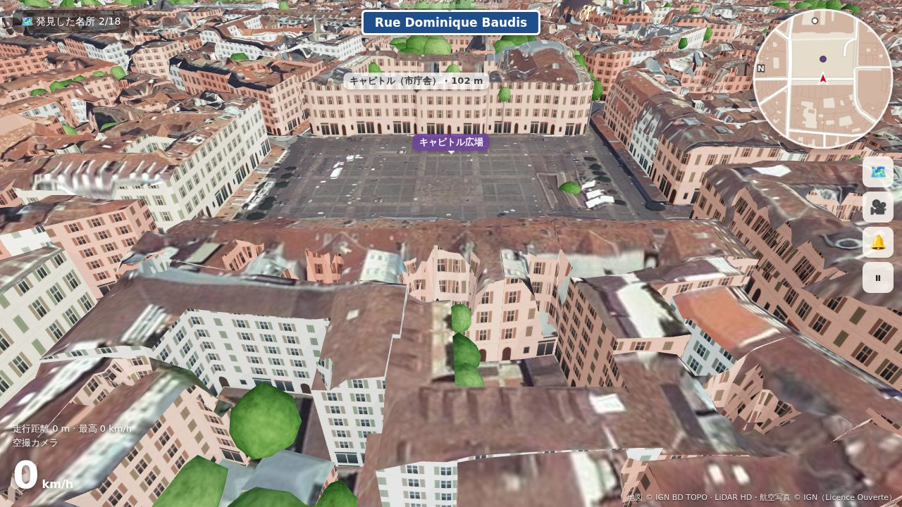
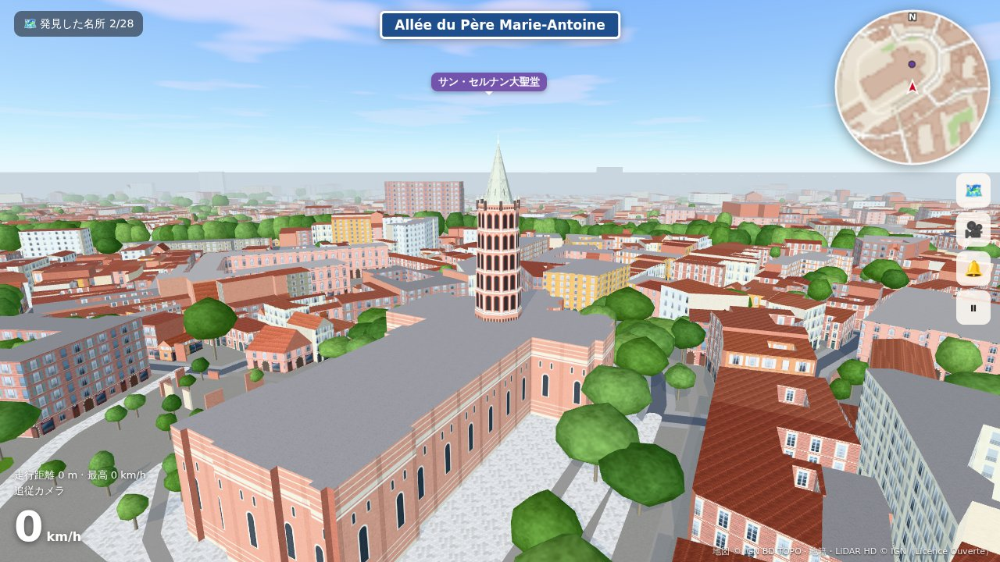
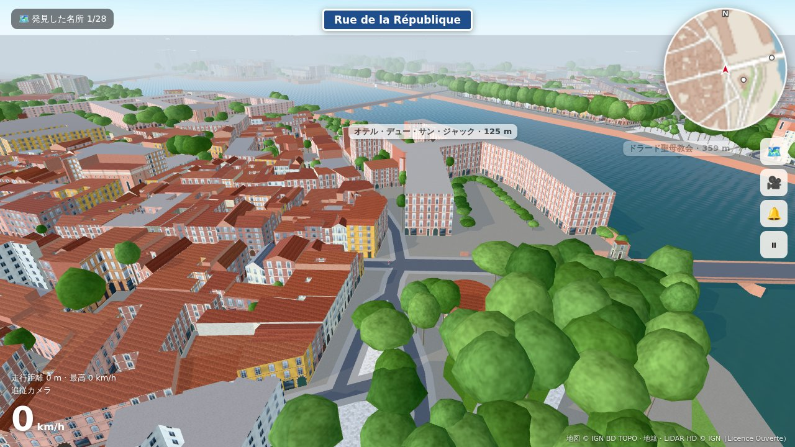
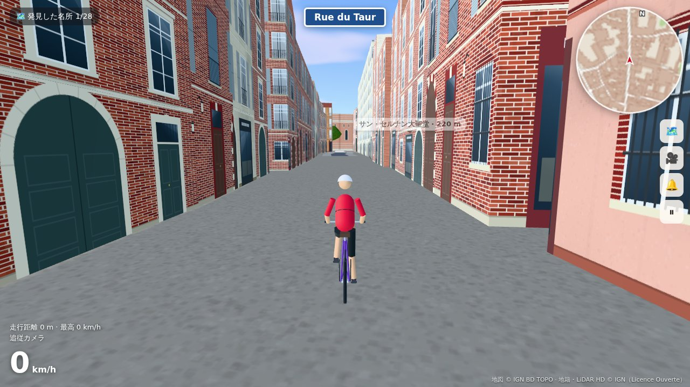
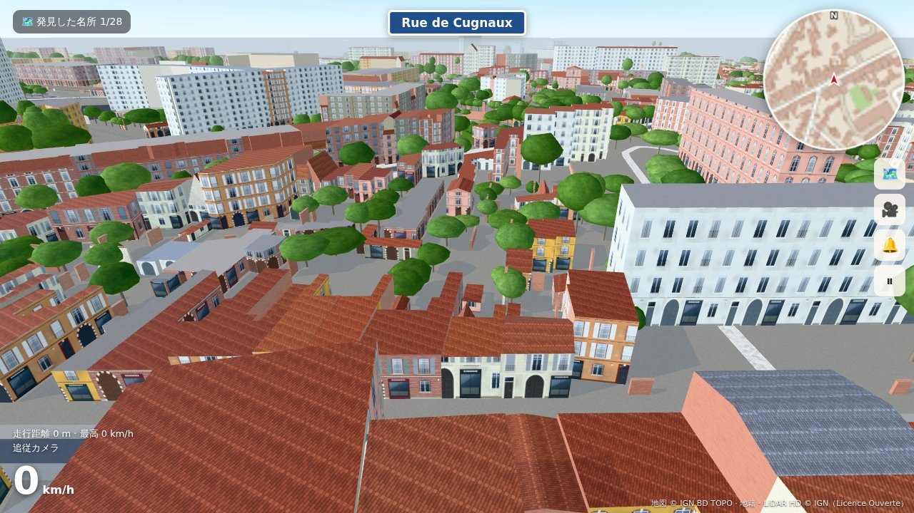
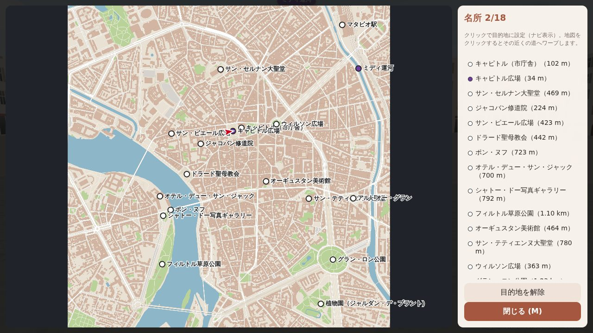

# Toulouse à vélo — トゥールーズ自転車散歩

実在のフランス・トゥールーズの街を 3D で再現し、自転車で自由に走り回れるブラウザゲームです。
建物・通り・川・橋・公園は実際の地図データ（OpenStreetMap と IGN BD TOPO）から自動生成しています。
敷地を隔てる塀と木は、IGN（フランス国土地理院）の地籍図（敷地の境界）と、航空機からレーザーで測った **LiDAR HD** の高さデータから、
実際にある場所に置いています。API キーや登録は要りません。

|  |  |
| --- | --- |
| キャピトル広場から市庁舎（キャピトル）を見る。正面は専用に描いたファサード | サン・セルナン大聖堂の八角形の鐘楼（半円アーチ 3 層・ミトラ形アーチ 2 層・石の尖塔）。写真を手本に、LiDAR で測った高さで作ったモデル |
|  |  |
| オテル・デュー・サン・ジャックの中庭。生け垣のように刈り込んだ木の列も LiDAR で見つけた本物の位置 | サン・セルナン大聖堂へ続く Rue du Taur。レンガに石の窓枠、漆喰の家、馬車門、鉄格子の窓 |
|  |  |
| サン・シプリアンの住宅街。庭や中庭を囲むレンガの塀と、庭の木 | 全体地図（名所を選ぶとナビ、地図をクリックでワープ） |

※ ソフトウェア描画の開発環境で撮影したため、実際のブラウザではもっとなめらかです。

## エリア

| エリア | 範囲 | 読み込み方 |
| --- | --- | --- |
| **トゥールーズ全体**（標準） | ポン・ヌフから半径 5 km（10 km 四方、建物 13 万棟・塀 13 万か所・木 26 万本）。旧市街に加えて、西のパーパン（病院・ローマ円形闘技場）、サン・シプリアン、ミニム、ランギュイユ、東のシテ・ド・レスパスまで | 自転車の周り（約 650 m）だけを作り、走るにつれて読み込む。遠くは霧に溶ける |
| 旧市街 | キャピトル広場から半径 1.2 km | まとめて読み込む |
| 軽量 | キャピトル周辺の半径 0.7 km | 古い PC・スマホ向け |

**トゥールーズ全体のしくみ**: エリアを 500 m 四方のタイル（420 枚）に分けます。
- 道路・川・公園・名所はエリア全体を最初に読み込むので、ナビ・地図・通りの名前はどこでも使えます。
- 建物・塀・木・道路の面は、自転車の近くのタイルだけを組み立て、離れたら捨てます。読み込みが間に合わないときは、その場で少し待ちます。
- タイルのファイルには、隣のタイルの境近くの建物も入れてあり、タイルの境でも隣の建物と接する壁を正しく扱えます。

## 遊び方

| 操作 | キーボード | ゲームパッド | スマホ |
| --- | --- | --- | --- |
| こぐ | `W` / `↑` | RT / A | 「こぐ」 |
| ブレーキ（止まっているときは後退） | `S` / `↓` | LT / B | 「ブレーキ」 |
| ハンドル | `A` `D` / `←` `→` | 左スティック | ◀ ▶ |
| 立ちこぎ（加速） | `Shift` | RB | — |
| ベル | `Space` | X | 🔔 |
| カメラ切替（追従 / 一人称 / 上空 / 空撮） | `C` | Y | 🎥 |
| 地図・目的地選択・ワープ | `M` / `Tab` | Back | 🗺️ |
| 道路に戻る | `R` | — | — |
| ポーズ | `Esc` / `P` | Start | ⏸ |

- **自由走行**: 街を走って名所（キャピトル、サン・セルナン大聖堂、ポン・ヌフ、ミディ運河など 29 か所）を発見します。地図で名所を選ぶと、実際の道路網でルートを計算してナビします。
- **名所めぐりタイムアタック**: キャピトル広場をスタートし、名所を順番に回ってタイムを競います（自己ベストを保存）。
- 画面上部には今走っている**実際の通りの名前**が表示されます。

## 「正確な再現」のしくみ

地図データは 2 つの公開データから取得します。

1. **OpenStreetMap**（Overpass API）＋ **IGN BD TOPO の実測の建物の高さ** … 通常はこちら
2. **IGN BD TOPO だけ** … OpenStreetMap のサーバー（Overpass API）が混んでいてつながらないと自動でこちらに切り替わります。タイトル画面の「グラフィック設定」で最初から選ぶこともできます（トゥールーズ全体は IGN だけ）

IGN（フランス国土地理院）の BD TOPO は、建物の軒の高さ・屋根の高さ・壁や屋根の材料（レンガ・石・コンクリート／瓦・スレート）、道路の幅・正式な通り名・橋・歩行者専用道まで持っている公的なデータです。

| 要素 | データ | 再現方法 |
| --- | --- | --- |
| 建物の形 | OSM（フランスの地籍図由来）または IGN | 外形を押し出して 3D 化。中庭（穴）、`building:part`（鐘楼など）にも対応 |
| 建物の高さ | ① OSM の `height` → ② **IGN の実測の高さ** → ③ OSM の階数 → ④ 推定 | IGN は航空写真測量による実測値（IGN で組み立てた旧市街エリアでは 12,307 棟中 99.7% が実測） |
| 屋根 | OSM の `roof:shape`、IGN の屋根の最高点・最低点・屋根の材料 | どんな外形（凹んだ形・中庭あり）にも重み付きストレートスケルトンで丸瓦の寄棟をかける。同じくらいの高さの隣と接する辺は切妻の壁にして、棟を通りと平行に通す。高さは IGN の屋根の高さ（勾配は丸瓦の 18〜42% に収め、超える所は平らな terrasson）。灰色の陸屋根はコンクリートの屋根・平らな屋根・大きな工場や商業施設の低い屋根だけ |
| 屋根の細部 | 屋根のストレートスケルトン（軒の辺・棟・隅棟）、隣と接する区間 | 旧市街・フォーブールの瓦屋根の家（1 階が店の家も含む。教会・名所・現代的な様式・22 m を超える集合住宅・工場・800 m² を超える商業施設・物置や車庫を除く）は、外周の軒の辺のうち隣の建物が軒より 1.5 m 以上低い 2.5 m 以上の区間に génoise（白い漆喰に丸瓦の端を 2〜3 段、1 段 9 cm・8 cm ずつ迫り出す）をつける。段は壁際から外へ迫り出す斜めの面 1 枚にまとめ、テクスチャの繰り返しで瓦の端の列と段の下面の漆喰を交互に見せる。角は留め継ぎ（鋭い角は留め継ぎのずれを 2 倍までに縮め、縮めた点も両方の屋根面にのせる）、見える外形の角の端は小口の三角形でふさぐ。屋根の軒の頂点を génoise の出 + 瓦の端の出（0.22〜0.30 m）だけ外へずらして同じ勾配で下げ、三角形を増やさずに軒の出をつける。煙突は床面積に応じて 1〜3 本（5 % の家はなし）、隣の家との境の切妻の頂とその 1.5 m 隣（2 本並ぶ煙突）、水平な棟の上から決まった乱数で選び、四隅の屋根の高さを測って立ち上げる（0.5〜0.7 × 0.4〜0.5 m、屋根から 0.8〜1.5 m、レンガか漆喰、丸瓦の笠かコンクリートの笠）。伝統的な家と 25 m 以下の瓦屋根の 3 m 以上の棟・隅棟（谷は除く）には屋根とほぼ同じ色の棟瓦の帯を載せ、軒まで下りる隅棟は軒の出で動かした屋根の角で止める。煙突と棟瓦は建物のチャンクの既存のメッシュ（窓のない壁・瓦）に入れ、génoise だけ専用の材料で 1 チャンク 1 メッシュ（影は落とさない） |
| 壁（ファサード） | IGN の壁の材料（レンガ・石・コンクリート） | 実際の街並みの写真を手本にした 11 の様式から材料に合わせて選ぶ: 薄いレンガ（brique foraine）に白い石の窓枠、レンガに木の鎧戸と鉄の手すり、彩度を抑えた黄土色・灰褐色・サーモン色・ばら色の漆喰にレンガの窓枠（レンガと石の交互積み）、クリーム色の切り石、現代的な建物、キャピトル広場を囲むアーケードのレンガ造り、19 世紀末の通りのオスマン様式（通りの名前で決める）、旧市街の外の戦後の集合住宅（白いバルコニーの帯）。旧市街（`config.js` の `OLD_TOWN`）のレンガ造り・材料不明の建物は 8 割がレンガの様式。窓台からの雨だれ、足元の暗い腰壁（約 0.8 m）、軒下と壁際の地面の陰で古びた感じを出す。1 階は馬車門・店・鉄格子の窓・玄関・壁付けの角灯。窓は壁の辺の中央にそろえ、最上階の窓が軒で切れないよう階の高さを調整。オテル・デュー・ラ・グラーヴ病院はレンガに石の窓枠 |
| 隣と接する壁 | 隣の建物の外形と高さ | 隣の建物と 0.8 m 以内で平行に並ぶ壁は、隣の高さまでは作らず（隠れるので）、それより上は窓のない壁（境界の壁）にする |
| 敷地を隔てる塀 | IGN の地籍（Parcellaire Express の敷地の境界）＋ LiDAR HD の表面モデル（0.5 m 格子）と地形モデル | 敷地の境界に沿って 0.5 m ごとに地面からの高さを調べ、「高さ 1.6〜7 m で、両側 1〜1.5 m より 1 m 以上高い、細い盛り上がり」が 2 m 以上続く所を塀にする。建物の上・木（両側も高い）・車（低い）は除き、1 m 以下のすき間はつなぐ（門などの開口は残る）。位置は境界から前後 1.25 m の範囲で実際に高い所へずらし、高さも実測。道路の上にかかる部分は切り取る。読み込むとき、高さ 4 m を超える塀のうち、ほかの塀とつながらない長さ 4 m 未満のもの（木・電柱の誤検出で細い柱に見える）は 2.5 m に下げ（2 m 未満は捨て）、建物に付いていない長い塀は 4 m に下げる。レンガ（ときどき漆喰）の壁に瓦の笠木 |
| 地面の覆い | IGN の地籍（敷地）＋ LiDAR HD（地面からの高さ）＋ IGN の赤外線航空写真（植生指数 NDVI） | 500 m のタイル（旧市街などは 500 m のブロック）ごとに 1 m 格子で、公道・広場（どの敷地にも入らない所）／敷地の中の地面（中庭・駐車場）／芝生／木の下に分けて焼き込む（DATA_VERSION 3）。描くときはタイルごとに 1 枚の板で、種類の境目をぼかしてテクスチャを混ぜる: 旧市街の広場（OSM の広場の多角形の中）はばら色がかった石畳、旧市街のそれ以外の公道（広い交差点・地図にない小さな広場など、通りの石畳の帯のあいだ）は通りと同じ小舗石、外は灰色の舗装、中庭・駐車場は灰色のアスファルトとコンクリート（ところどころベージュの砂利）、芝生、木の下は暗い草と土。読み込むとき OSM で補正する: 広場の多角形の中の敷地は公道（芝生と木の下は残し、広場の多角形は描かない）、名前が「Allées …」の道の近くの木の下・公道と François Verdier の並木道の広場は灰色のコンクリートの舗石、公道に囲まれた細長い樹冠の下（タイルの端に接しないもの）も舗石。覆いのある所は OSM の緑地を描かない（運動場の人工芝は近赤外を返さないので残す）。Place Olivier は赤みがかった黄土色の固めた砂利・樹脂舗装 |
| 木 | LiDAR HD の表面モデル − 地形モデル（樹冠の高さ） | 樹冠の頂点を探し、本物の位置・高さ・枝の広がりで木を置く（トゥールーズ全体で約 26 万本）。樹冠は高さに見合った大きさに抑え（平たい板にしない）、横に広い低い塊は 2〜3 本に分ける。樹冠は木ごとに違うこぶのある形、幹は途中で二股。街路・運河・河岸の木はまだらな樹皮のプラタナス。建物の上・水の上・道路の真ん中は除く。LiDAR がないエリアでは、公園に木を補い、並木道（Allées・Boulevard など）に木を植える |
| キャピトル | 広場に面した建物の壁 | 専用の正面: 1 階はレンガと白い石の縞、2 階はばら色のレンガに白い付け柱、中央に 8 本のばら色の大理石の円柱と「CAPITOLIUM」の破風、屋上の手すりと壺 |
| 教会 | IGN の建物の種類（教会） | 南仏のレンガの教会の壁（白い石の帯・控え壁・半円アーチの高窓・軒下の小窓） |
| 鐘楼 | LiDAR HD で測った尖塔の位置・高さ・鐘楼の太さ・付け根の高さ | サン・セルナン（半円アーチ 3 層＋ミトラ形アーチ 2 層・小塔の冠・石の尖塔、高さ 67 m）とジャコバン（ミトラ形アーチ 4 層、46 m）の八角形の鐘楼を、写真を手本にモデルで作る |
| 名所のモデル | 建物の外形（IGN）・広場の外形（OSM）・写真とユーザーの写真のメモ | シャトー・ドー（円形のレンガの基壇と 3 つの半円アーチの扉・円筒の塔・手すり付きのテラス・灰色のドームと風見・黒い鉄柵〔道路の上には立てず、当たり判定は立てた区間だけ。街の小物は柵に抜けがあっても柵の円の内側に置かない〕。交差点から塔が見えるよう柵の外の歩道まで木を植えない）、スタディアム（外形と中庭の穴から白い外壁・紫の観客席のすり鉢・屋根・ピッチ・屋根の上に立つ 4 本の照明塔。外壁に食い込んだ角の塔も白い外壁に）、メディアテーク・ジョゼ・カバニス（高さ 25 m 以上の外形〔細い切れ端も含めて〕をまとめた門の形と、真ん中の外形の幅で決めた幅とほぼ同じ高さの四角い開口〔下は通り抜けられる〕、テラコッタ色のルーバーと白い階の帯、ジャン・ジョレス通りの軸の側〔門の正面〕へ張り出したガラスの庇）を元の外形の代わりに描く。キャピトル広場の正面の軸の上にはブロンズのオクシタン十字（12 の玉に星座のメダル。低い視点で黒く見えないよう金属感は控えめ）を石畳に埋め込み、オリヴィエ広場には蹄鉄の雄鶏の像（赤い台）を、写真のとおり見える車道（広場の舗装の下を通る道は除く）の縁石から 2.5〜4 m の歩道の上、車止めの列のすぐ後ろに、車道の方へ向けて置く（建物・車道にはかけない）。Route de Bayonne のマクドナルド（ユーザーのストリートビューと航空写真）は、暗い灰色の外壁と赤茶の帯の平屋（道路側は大きなガラス、横は木の板張り、正面に赤い板と黄色の M）、道端の高さ 9 m の看板塔、道路との間の白い砂利の植え込み（赤茶の木のチップの島）。どれもストリーミングでも一度に作るエリアでも、タイルごとに 3 本以下の描画コール |
| 利用者の写真の場所 | `photos/` の写真とストリートビュー（82 枚。写真に写った所は航空写真・標高より写真を優先） | キャピトル広場は灰色の小舗石に淡い石の斜めの帯、縁に花崗岩の角石・ベンチ・車止めと暗い植木箱、暗い灰青色の高い燭台形の街灯、木なし、1 階がアーケードなのは西側だけ。Rue d'Alsace-Lorraine・Rue de Metz・Esquirol・Rue du Languedoc に面した建物はオスマン様式（砂色の切り石・鎧戸なし・2 階と 5 階に通しの鉄のバルコニー・1 階は全部店・灰色の亜鉛の屋根）、Alsace-Lorraine の舗装は暗い灰色の花崗岩の板にばら色の横縞、Esquirol と Rue de Metz の歩道は赤茶色。Allées Roosevelt は壁から壁まで淡いばら色がかったベージュの石の板で、並木はタイサンボク。街路樹は幅と同じくらいの高さの樹冠（大きな木ほど幹が高い）、旧市街の通りの木の下は石畳。水は青灰色の静かな水面。Port Saint-Sauveur の岸は石の岸壁、ブリエンヌ運河の岸は草の斜面。河岸の並木は岸壁の上の段に立つ。ポン・ヌフの歩道は灰色の花崗岩（Place du Pont-Neuf と Quai de la Daurade も小舗石ではなく車道と灰色の歩道、橋の北の欄干の端から河岸の手すり壁が続く）、カタラン橋は淡いコンクリート、サン・ピエール橋はレンガの橋脚と弧の下弦の鋼のトラス。左岸のサン・シプリアンの通りはアスファルト（石畳は右岸の歴史的な中心だけ）、Rue de la République は漆喰の色の建物、Rue Laganne の東の歩道沿いに Cours Dillon を支える擁壁。ジャン・ジョレス通りは 2023 年のランブラ（2 本の車道を建物の前へ移し、あいだを固めた砂の遊歩道と低木・若い木の植え込みに。`world/ramblas.js`）。旧市街の外の背の高い戦後の集合住宅はサーモン色の漆喰と白いバルコニーの帯、Rue d'Alsace-Lorraine の真ん中寄りに低い植え込み、キャピトルの正面は一続き、Square Charles-de-Gaulle とキャピトル広場には LiDAR の塀を置かない。名所: シャトー・ドー（細くなる塔・石の手すりの回廊・暗いスレートのドーム）、ラ・グラーヴの円屋根、キャピトルの主塔、ラ・ドラード大聖堂の柱廊、サン・セルナン大聖堂の段々の後陣、サン・テティエンヌ大聖堂の石の内陣（控え壁・尖頭アーチの窓）、オーギュスタン美術館のアーケードの正面、オテル・デューの川側（破風・水際のアーチ・古い橋脚の跡）、メディアテーク（高さの約 2/3 の開口・暗いえんじ色のルーバー・ガラスの最上階）、リケの像、Port Saint-Sauveur のカピテヌリーとつないだ平底船、Place Intérieure Saint-Cyprien の石の島、パット・ドワのロータリーの島と鋼の門の彫刻、Place Intérieure Saint-Cyprien の西の端の入市税の門の小屋 2 つ（淡い石・三角の破風と壺の飾り。位置は航空写真）、サン・ピエールの閘門（ブリエンヌ運河の口の、石積みの閘室・錆色の扉・格子の床の歩道橋・X の筋交いの鉄の柵。地形モデルでは浅い窪みなので地面を切り抜いて描く。`world/locks.js`）、マクドナルド（Route de Bayonne）、日本庭園（縄の柵・飛び石・竹）、オテル・デューの中庭。ポン・ヌフの街灯は欄干の内側の台座と鐘の形の灯具 |
| 屋根の色 | OSM の `roof:colour` など、IGN の屋根の材料 | 瓦・スレート・亜鉛などの色 |
| 道路 | OSM の `highway`、IGN の道路の種類・幅・通り名 | 車道・歩道・歩行者専用道・自転車道を描き分け、実際の通り名を表示。旧市街の細い通りと歩行者の通りは壁から壁まで小舗石（一部は Rue du Taur 型の石の板の歩道、広い通りは石の板。広場・緑地の中には敷かず、旧市街の地面そのものも小舗石なので広い交差点や地図にない小さな広場も土にならない）、それ以外の車道は高さ 13 cm の花崗岩の縁石と、建物の壁まで延びる一段高い歩道（えんじ色か灰色。広場・緑地・駐車場・線路の手前で止まる）と 2 列の小舗石の側溝。旧市街の交差点と幹線道路どうしの交差点には横断歩道と停止線（優先道路の側には引かない）、中心部の角には黒い車止め。幹線道路どうしの交差点と、中心部で 2 車線以上の幹線道路に脇の車道が 2 本以上つながる交差点（ポン・ヌフの両端など。信号の位置のデータがないので）には、交差点へ向かう車の右の歩道の停止線の所に信号機（高さ 3 m の灰色の柱と 3 灯の灯器）。自転車レーンのある道と中心部の信号の停止線の後ろには、緑の自転車の待機ボックス（sas vélo、4 m の緑の帯と自転車マーク）。路面の標示（`markings.js`、ユーザーのストリートビューを手本に）: 両方向の 6 m 以上の車道（住宅街は 8 m 以上）に中央線（3 m の線と 10 m のすき間、幅 12 cm。4 車線以上は実線）、車線の数（IGN の `nombre_de_voies`）で車線の破線、9 m を超える広い道の路側線。バスレーン・自転車レーンはデータにないので通りの名前の一覧（Pont Neuf・Rue de Metz は太い実線と「BUS」、Rue de la République・Allées Jean Jaurès・Avenue de Grande-Bretagne・Route de Bayonne・Avenue Étienne Billières は 1〜1.5 m の自転車レーンと自転車・矢印のマーク。Route de Bayonne のレーンは赤い舗装）と OSM の `cycleway=lane` から。一覧の通りはそのレーンを優先し、一般の車線を 2.5 m まで狭める（狭い一方通行の Billières の片側 3.5 m にも自転車レーン。足りなければ中央線を引かない）。IGN の区間ごとに途切れないよう、狭い区間でも一般の車線を 2 m まで狭めて 1 m のレーンを通す（Rue de la République は Pont Neuf の袂まで）。レーンが縁石に沿う側には路上駐車せず、どこから置いた車（隣の区間の縁石の列・車道にかかる駐車場の区画）もレーンの帯にかかれば置かない。自転車レーンの通りの停止線の後ろには緑の自転車の待機ボックス。中心部の住宅街の道は格上の道から入った所（ゾーンの入口）の出ていく車線に「30」（サン・シプリアンは「20」。同じ道では 150 m 以上あける）。一方通行の向きは IGN の `sens_de_circulation`（'Sens inverse' は頂点の順を逆にする。古い形式の同梱データは `public/data/<エリア>-oneway.json` の一覧で直す。この一覧は git にないので、取得し直した後は `npm run fetch-data -- all --oneway` が要る。ないとコンソールに警告を出し、逆向きのまま遊べる）で、矢印・文字・レーンの側・駐車の向きがそろう。自転車道は赤茶色の舗装に 25 m おきの白い自転車マーク。線は交差点の中と、横断歩道・停止線の 2 m 手前で止める。位置は道の始点からの距離で決め、中心がタイルにある物だけを書くので、タイルの境で継ぎ目なくつながる（線は 1 つ、絵はアトラス 1 枚で 1 つの描画コール）。トラムの線路（Avenue de Grande-Bretagne など）は芝の軌道の帯（車道・横断歩道を横切る所は切ってアスファルトと横断歩道を見せ、レールだけ通す）と、約 35 m おきの灰色の架線柱（路面電車の幅 2.4 m にかからない所: 複線は 2 本の線の真ん中に 1 本立てて腕を両側へ、単線は線の 2.2 m 横。車道・横断歩道を横切る所には立てず、その先へずらす）と高さ 5.8 m の架線 |
| 街の小物 | 通りの断面（縁石と歩道）、OSM の広場・駐車場（`amenity=parking`）、横断歩道 | 写真を手本に、タイルごとに通りの縁石の区間から置く（位置は道の始点からの距離で決めるので、タイルの境でずれない。建物の中・名所の台や柵の内側には置かず、タイルの境の歩道では隣のタイルの建物も避ける）。「旧市街」の小物は右岸の歴史的な中心だけ（旧市街の範囲のうちガロンヌ川の流れの真ん中の線 `GARONNE_AXIS` より東。左岸のサン・シプリアン、Place Olivier・Château d'eau の角は外と同じ）。街灯: 旧市街の外の車道の歩道に約 27 m おき（広い通りは左右交互、狭い通りは片側）。中心部（ポン・ヌフから 1.3 km、サン・シプリアンを含む）は灰緑の柱に白鳥の首の腕と吊り下げの灯具（高さ約 6.5 m）、その外は灰色の柱と横向きの灯具（約 7 m）。広い大通り（と Allées Jean Jaurès・Avenue de Grande-Bretagne・Route de Bayonne）は両側に細い鋼の高い柱と斜めの腕（約 9 m）、幹線の環状道路とスタジアムの近くは高い円盤形の街灯。旧市街は建物の壁の街灯のまま、広場の縁に黒い燭台形の街灯（外周を最大 8 等分）。キャピトル広場は縁から 6 m 内側に灰色の高い 5 灯の燭台形の街灯を約 12 本（キャピトルの正面の側はあける）と、西と南のアーケードの前にカフェのテラス（白い四角のパラソル・テーブル 2 つ・椅子 4 つ）、Place Wilson の縁にもテラス。街灯は影を落とす（細い白鳥の首・鋼の柱の街灯とテラスは影の描画コールを減らすため落とさない）。花崗岩の円柱の車止め（直径 28 cm・高さ 55 cm・頭が丸い）: 広場（Place Olivier など）と中心部の広い歩道が車道に接する縁石に 1.4 m おき（広場の下を通る道は使わず、広場の縁より内側には立てない。横断歩道の所はあける）。歩道は同じ所に黒い細い車止め（potelets、9 cm 角・高さ 1 m・頭に白い帯。旧市街の Alsace-Lorraine なども。一続きにせず約 7 m の組ごとに 3 割ほど抜く）、花崗岩の円柱は広場と Rue de Metz だけ。路上駐車の車（車体・上ほど細い客室〔傾いた前後の窓、紺がかった暗いガラス、車体の色の柱と屋根〕・少し暗いバンパー・車輪、白・銀・灰が大半で黒は少ない）: 旧市街の外の住宅街・二次的な通りで、車道に自転車の通る幅 3 m を残せる所（5 m 以上で片側、7 m 以上で両側）に縁石に沿って縦列に。車道が 4〜5 m の住宅街の通りは、歩道が 1.6 m 以上あれば片側に歩道へ半分（85 cm）乗り上げて少し傾けて（フォーブールの通りのように。車道は 3 m 残る）。交差点・横断歩道・橋の端・トラムの近くはあけ、駐車場には背中合わせの列に約 2/3。ごみ箱（黒い輪の形）: 横断歩道の角・広場・ときどき歩道。大きなごみ収集容器（緑・青）: 広い歩道にときどき。種類ごとに 1 つの InstancedMesh で、自転車から 280 m より遠い物は描かない（描く物だけを囲む球で視錐台カリングも効く。一度に作る街は始まる前に近くの物を選ぶ）。車・容器・柱・車止めには当たり判定 |
| 質感 | Wikimedia Commons のトゥールーズの写真（手本として見るだけで、画像は使っていない） | レンガ: 長さ約 36 cm・厚さ約 5 cm の薄いレンガ（brique foraine）に太い砂色の目地、縦目地は不規則、焼きムラ。塀は地面際の湿気と雨だれ、漆喰の塀ははがれた所からレンガがのぞく。屋根: 丸瓦（tuile canal）の山と谷、瓦ごとの焼き色の違いと苔（テクスチャの平均は明るめにして、上から見た旧市街の屋根の連なりが写真の橙〜赤茶 #b0705a〜#c08060 になるよう屋根の色で決める）。車道: 骨材の粒・ひび割れ・補修跡のあるアスファルト。歩行者専用の通り: 淡いベージュの石の板を段ごとにずらして敷いたもの |
| 川・運河 | 水域ポリゴン | ガロンヌ川（平均の幅 60 m 以上の川）は約 10 m 下を流れる（何枚にも切れた川の水面は、長い継ぎ目でつながったものを同じ深さにそろえ、支流・運河の口・池との段差には石の壁を作る）。旧市街のまわり（ポン・ヌフの西、半径 1.25 km）の岸は高いレンガの岸壁（少し傾き、明るい石の根石と笠石、35 m ごとの付け柱）、その外は幅 5〜16 m の小段のあるゆるい草の土手（上の縁は丸め、斜面と小段に川辺の木。橋の下と両脇は垂直の石の橋台で、土手の切り口は石の袖壁）。運河は 500 m ほどの区間ごとに草の斜面か、草の土手の下に低い石積み（約 1 m、笠石付き、切石）で、橋・閘門の近くだけ高さいっぱいの石の壁。水はにごったオリーブ色の灰緑（運河は暗い緑）で、弱い波を 2 枚重ねて流し、空は斜めから見たときだけ映る。岸壁の際は暗い。橋だけ渡れる（橋の下で切り抜かれた水面は、橋が渡る水路の深さで埋め直す。運河の口では運河の深さで、川へ下りる壁まで。運河に長く接する池・船だまりは運河の水面） |
| 光と空 | — | 暖色の太陽（影を落とす）と、空の青・レンガの照り返しの半球光、弱い環境光（空のシェーダーから明るさを測って強さを決める）。地平線のもやと霧は灰色がかったばら色で、遠くの街並みが空に溶ける |
| 橋 | OSM / IGN の橋の道路 | 深い水を渡る石の橋は、水の区間に橋脚とかご形のアーチを並べ、迫石の輪・レンガのヴォールト・スパンドレル・尖った水切りと段々の石の笠・石の蛇腹と欄干を作る。ポン・ヌフは実物の大きさの違う 7 つのアーチ（中ほどが最大約 30 m）、白い石とレンガが交互の迫石、橋脚の上を貫く丸い穴（デグロワール）、淡い大きな切り石の欄干と街灯の台座（レンガではなく花崗岩の板のテクスチャに暖かい白をかけ、1.2 m × 0.6 m の石と細い目地）、両側の広い淡い花崗岩の板の歩道（車道の縁に濃い石の帯）、灰緑の柱に白鳥の首の腕と吊り下げの灯具 1 つの街灯（写真 10・11）、車道のバスレーン（「BUS」）・自転車レーン・車線の線。データに橋の構造・材料がないので、石のアーチ橋は実物が石積みの橋（ポン・ヌフ、ポン・デ・カタラン、ポン・ド・ラ・クロワ・ド・ピエールなど）だけ。ほかの深い水を渡る橋と、高速道路・幹線道路を含む橋は近代の橋（薄い桁と細い橋脚）、陸の上の高速道路・幹線道路の高架（Avenue de Grande-Bretagne の上の A620 など）は淡いコンクリートの厚い桁とコンクリートの縁の上の青灰色の鉄の手すり（支柱 1.6 m おき、高さ 1.1 m）。高速道路の高架の下をくぐる車道の両脇（高架から前後 90 m）は、盛り土の斜面の足元に盛り土の上までの淡いコンクリートの擁壁（上から 0.5〜1.1 m に赤い帯、当たり判定あり。盛り土を上る道を横切る所は作らない）、運河の橋は平らな橋。車道の橋に並ぶ歩道・ランプの橋は 1 つの橋にまとめ（いちばん主要な道が親）、親と同じタイルで作る |
| 地形（標高差） | IGN LiDAR HD の地形モデル（MNT、地面だけの高さ）と表面モデル（MNS） | 事前取得で 2.5 m の地形モデルを取り、5 m の格子（緯度経度に固定。どのエリア・タイルでも同じ所は同じ高さ）にして、0.02 m 単位で `public/data/<エリア>-terrain.bin` に保存（トゥールーズ全体で約 3.4 MB）。高さは y = 標高 − 145 m（ポン・ヌフの右岸の端がほぼ 0）。旧市街は −2.5〜+1 m、左岸の低い段丘（サン・シプリアン）は −8〜−6 m、パーパンの台地は +5〜+6 m、ジョリモン・コート・パヴェは +47 m、ペシュ・ダヴィッドは +93 m 以上。平らな所だけならし、土手・岸壁・切り通しの段差は残す。川・運河の上は地形モデルが水面で平らなので、その値を水面の高さの格子にし（ガロンヌ川はラミエの堰の上 137.0 m・バザクルまで 132.5 m・その下 127.5 m から下流へ下がる、ミディ運河は閘門ごとの段）、地面の格子は岸から延ばす。長い橋は表面モデルの帯から橋面の縦断面を測る（車・街灯・木を除く。読み込むときに「両端を結ぶ直線 + 上向きのアーチ」から上へ 1.5 m・下へ 0.5 m 外れた点を捨て、たわみは残さない）: ポン・ヌフは右岸の端 145.1 m から川の上で 146.9 m まで上り、左岸の端 142.1 m へ下がる。橋の両端は、ふつうの道路につながる所では必ず道路の高さに合わせ（差が大きい橋は橋の中に 4.5 % 以下のなめらかな坂を作る）、高架の続きの所はつながる橋の端と揃える。読み込んだあと、車道の縦断面で格子をならし（中心線の前後 ±15 m の平均。車道の幅 + 1 m は横に水平、そこから 6 m で元の地面へ。水の上の区間は両岸の高さを結ぶ。重なる道は幅の広い道・中心に近い道を強く）、旧市街のまわりの岸壁は、水辺から 45 m 以内で低い側が水面 + 4 m 以下の所だけ、5 m の格子のなまった斜面を 1 マスの段差に戻して、上の河岸から下の遊歩道まで垂直のレンガの壁を立て、上の河岸の縁にレンガの手すり壁（1 m）と、そこから河岸の車道の縁まで（6〜14 m）淡い花崗岩の敷石の歩道の板（先の縁は下へ垂らす）を付ける。壁は下の段の格子点を結ぶ地面の三角形の辺の上に立てるので、壁の前の地面は必ず平らで（川から見て壁の足元に地面のとげが出ない）、壁の裏の 1 マスの斜面は歩道の板で隠し、自転車・並木・街灯は板の高さに載せる（地面のメッシュ・道路の面は格子のまま）。板の角は、まわり 7 m の壁の向きの平均でそろえてすき間なくつなぐ（上の段は隣の車道の高さにもそろえ、車道の近くは車道の芯 + 15 cm より上げない〔地形モデルに本物の手すり壁が写っている〕。段に入らなかった車道の芯の点も、隣の下の段より 3 m 以上高ければ上の段として壁の線を引く〔ドラード河岸で手すり壁が点線のように途切れていた〕。水の上の格子点と車道の上は触らないので、壁は車道の手前で切れる。車道の脇のならした帯は直すので、岸壁のすぐ上を走る河岸の道の下でも壁は途切れない。斜面に沿って走る遊歩道（道に沿った勾配が地面の勾配の半分未満。5 m の格子では斜面の途中に載っている）は下の段にして、ドラード河岸のように船着き場の遊歩道が岸壁の足元を平らに走る。下の段は水面 + 0.9 m より下げない。岸壁の足元には淡い石積みの帯（1.3 m）。遊歩道へ下りる歩道・自転車道・小道の坂と階段（中心線の前後 ±8 m で 0.6 m 以上の高低差がある所）のまわりも元の坂のまま残し、車道でない道を横切る壁・道の幅の中に入る壁は作らないので、自転車で遊歩道へ下りられる。ただし道が壁に沿って走る所〔前後 3 m の高さの差が 1.2 m 未満〕の 4 m 以上の高い岸壁は残す〔ドラード河岸の下の遊歩道は岸壁の足元を通る〕。壁には当たり判定がある）。最後に格子の 1 点だけの穴・とげ（1 m 以上）を近くの中央値に戻す（world/terraincond.js）。地面はタイルごとに格子の三角形そのもの（地面の覆いも同じ三角形に描く）、エリアの外 5 km までは 80 m の遠くの地面（読み込んだタイルの中は描かない。タイルの縁には 8 m の垂れ幕を下ろして、丘の上で 2 つの格子の高さが違ってもすき間が見えないようにする）。道路・歩道・縁石・標示は格子の線と対角線で切って地面と同じ平面に載せ（長い面も坂に沿い、地面が突き抜けない）、建物は外形の中のいちばん高い地面の 0.3 m 下（ただし低い方から 2 割の高さ + 4 m まで）に建てて、坂の上側の入口・窓が埋まらないようにし、坂の下側に台座を足す（中庭の壁の下にも）。塀・木・街の小物（路上駐車の車は坂に沿って傾ける）・名所も地面の上に（塀の上端は地面をそのままなぞらず、2 m ごとに「低い側の地面 + 塀の高さ」と「高い側の地面 + 1 m」の大きい方を ±4 m で包んで平均したなめらかな線にし、足は地面の下へ埋める。河岸・土手の段差を斜めに横切る塀の上端が 5 m の格子ごとにのこぎりの歯にならない。塀から両側へ 5.5 m 先の地面（と塀の足）の高さが 1.2 m 以上違えば土留めの壁として扱い、上端は高い側 + 1 m（LiDAR の塀の高さは低い側の本当の地面から測った値なので使わない）、高い側に 5.5 m の淡い花崗岩色の平らな面を張って、盛り土の道（ポン・ヌフ左岸の取り付け道路など）と塀の間の土の斜面を隠す。）、水面・岸壁・土手は本当の水面と岸の高さに、橋の欄干・アーチ・橋脚は縦断面に合わせる。自転車は地面と橋の面に乗り（橋の下の河岸では橋の上に上がらない）、上りは脚の力（通常 320 W・立ちこぎ 520 W）で遅く、下りは速い（平ら約 30 km/h、5 % の上り約 20 km/h、6 % の下りを惰性で約 40 km/h）。岸壁の縁や急な土手は壁と同じに止まり、橋の上から橋の外へ、または高さが 0.5 m 以上違う隣の橋の面（同じ橋の並んだ車道）へ移る所は下に道路があっても止まる（欄干）。スタート・やり直し・ワープは地面の高さに置く（橋の下の道路で橋の上に置かない。置く道そのものが橋なら、陸の上の高架でも橋の面）。霧は解析的な指数の高さの霧（カメラから点までの線に沿って、カメラの少し上より高い所の霧の濃さを 12 m ごとに 1/e に薄くして積分する）で、距離とともに必ず濃くなり、遠くの丘は霧の上に稜線が見える。遠くの地面だけは、900 m より先で霧の終わりを 2.5 km で 3.5 倍まで遠ざけ、少し青い霞の色にする（平らな所は霞に沈み、ジョリモン・ペシュ・ダヴィッドの丘が浮かぶ）。地形モデルの範囲の外は、一番近い縁の高さから 2.5 km かけて地方の平均（縁の平均を 160〜200 m に収めた値）へ移し、波長 1.6 km・0.6 km のゆるやかなうねりを足して丘を続け（平らな台地の縁が海辺のように見えないように）、カメラから 4〜4.95 km で高さによらず霧の色（空の地平線の色）に消す（遠くの地面の縁と青い帯は見えない）。水の穴（ステンシル）と水面は 500 m ごとのメッシュに分けて、見えない所は描かない。地形のファイルがなければ、ゲームが地形モデルをその場で取得し（橋は端の高さを結ぶ）、それもだめなら平らな地面 |
| メトロの駅の出入口・地下駐車場の坂 | IGN BD TOPO の駅と地下駐車場（equipement_de_transport の 'Station de métro'・'Parking souterrain'）、LiDAR HD の地形モデル（0.5 m）、写真（Wikimedia Commons） | 事前取得で、営業中の駅ごとに駅の中心から ±110 m の地形モデルを取り、16 m の窓で穴を埋めた面より 1.2 m 以上低い細長い穴（階段・エスカレーターの吹き抜け。8〜300 m²、長さ 4.5 m 以上、幅 13 m 以下で長さが幅の 1.3 倍以上）を探す。建物の中（地形モデルは建物の下を補間するので偽の穴ができる）・駅から 95 m より遠い穴・深さ 1.8 m 未満は捨て、駅ごとに深さ × 長さの大きい順に 4 か所まで（トゥールーズ全体で約 70 か所。`public/data/<エリア>-metro.json`）。向きは穴の凸包を囲む面積が最小の長方形の向きで、近くの建物の壁の向き（15° 以内）にそろえる。長い向きに沿った深さの傾きから下りる向きを決め、浅い上の段の分だけ上の端を延ばす。地下駐車場（BD TOPO の 'Parking souterrain' の印）のまわりも同じように調べ、印から 30 m 以内の長い穴（深さ ÷ 長さ 0.4 以下）と、100 m 以内の長くなだらかな穴（長さ 12 m 以上・幅 3.2〜13 m・深さ ÷ 長さ 0.22 以下。階段の吹き抜けは 0.3 以上）は車の坂にする（キャピトル広場の坂など、トゥールーズ全体で約 30 か所。駅のまわりで見つけた穴も同じ規則で分ける）。車の坂は、灰色のコンクリートの壁のあいだのアスファルトの坂（2 車線の幅なら真ん中に白い破線）、下の端に暗いトンネルの口と黄色と黒の高さ制限の梁、コンクリートの腰壁とステンレスの手すり、入口に高さ制限の門と青地に白い P の看板。入口（上の端）は車道に近い方の端にする。吹き抜けの中には木を植えない。ゲームでは、地形の格子の穴を周りの高さ（外周の 6 割の所）で埋め、吹き抜けの長方形を水面と同じステンシルの穴にして（地面・地面の覆い・道路・歩道を描かない）、中に階段（16 cm の段）・ステンレスの欄干と黒い手すりのエスカレーター（幅 4.2 m 以上）・下の踊り場とガラスの扉を作る。3 辺にベージュの花崗岩の腰壁（1 m）とステンレスの手すり、入口の脇に看板の柱（黄色地に紺の丸と M、駅名の黒い帯、黄色の駅の絵の板）。吹き抜けには当たり判定があり、LiDAR で塀として見つけた腰壁は塀にしない（world/metro.js）。屋根のある出入口・建物の中の出入口・地形モデルに穴が写っていない駅（Carmes など）は作らない |
| 通路 | 道路が建物の外形を横切る箇所 | 建物の下をくぐる通路として通れるようにする |

塀と木は地図データの事前取得（`npm run fetch-data`）のときに見つけて、同梱データに入れておきます。
同梱データのないタイルは、ゲームが IGN から地籍と LiDAR を取得してその場で見つけます（1 タイル約 5 MB）。

ゲーム中に `Esc` でポーズすると、建物の高さが「IGN 実測 / OSM / 推定」のどれから来たかの内訳や、塀と木の数が見られます。

### 既知の限界

- 窓・扉は実際の街並みを手本に手続き的に描いた様式です。建物ごとの本当の窓の配置や色ではありません（キャピトルの正面だけは専用）。教会などのモニュメントの装飾は再現されません。
- 地形は 5 m の格子なので、5 m より細かい段差（階段・低い擁壁）はなだらかな坂になります。建物の土台は外形の中の地面から決めた 1 つの高さで、坂のとても長い建物（坂の上下の差が 4 m を大きく超えるもの）は坂の上側の壁が少し地面に埋まります。レンガの岸壁は地形モデルの段差から自動で立てるので、実際の岸壁より短い所・車道の手前で途切れる所があります。地形があると、1 フレームの描画の回数・三角形は平らな地面のときより増えます（ポン・ヌフ付近で描画の回数 約 1.4 倍・三角形 約 1.9 倍、川の上の空撮では約 820 回）。橋として描かれていない短い橋の取り付けは、切り通し・運河の岸の斜面のなまりで 1〜2 m くぼむことがあります（ガブリエル・ペリ橋）。地下道・切り通しの道は地面の高さを走ります。
- 塀は「敷地の境界の上にあるもの」だけです。敷地の中の塀や、木に覆われた塀、低い塀（1.6 m 未満）は見つかりません。生け垣が塀になることもあります。
- 橋の形は、ポン・ヌフ以外は種類ごとの決まった形です（アーチの数と大きさは水の幅から決めます）。橋面の縦断面は 30 m 以上の橋だけ実測で、短い橋は両端の地面の高さを結びます。
- 遠くの街並み（約 1 km より先）は表示しません。
- 走る自動車・歩行者はいません（路上駐車の車は止まっているだけ）。一方通行も無視します（ゲームなので）。
- VélôToulouse（貸し自転車）の駐輪場はありません（位置のオープンデータ data.toulouse-metropole.fr にも Overpass API（OSM の `amenity=bicycle_rental`）にもデータ作成の環境から接続できず、同梱の地図データにも駐輪場がないため）。
- バスの走る通りは地図データにないので、路上駐車はバス路線を避けません（トラムの線路の近く、一覧の通りのバス・自転車レーンの側はあけます）。路面のバスレーン・自転車レーンは通りの名前の短い一覧だけです。
- バス停・モリス柱はまだありません。写真と比べて残っている違い: Port Saint-Pierre とラ・ドラードの下の段の河岸（石畳・小石の浜・2 段の岸壁）、サン・ピエールの閘門、A620 の高架の桁、Purpan の塀と病院の門、Place du Pont-Neuf の歩道の石の板、運河の水面に見える細い線など。信号は位置のデータがないので、交差点の形から推定して立てています。
- 再現の精度は元データに依存します。OSM のおかしな箇所は [OpenStreetMap](https://www.openstreetmap.org/) を直すと、次回のデータ取得から反映されます。

## 開発

```bash
cd toulouse-a-velo
npm install
npm run dev          # http://localhost:5173 で起動
```

初回起動時、ブラウザが Overpass API（OSM）と IGN Géoplateforme の WFS から地図データをダウンロードします（30 秒〜数分）。Overpass に 100 秒つながらなければ IGN だけで組み立てます。取得したデータは IndexedDB にキャッシュされ、2 回目以降はすぐに始まります。

### 地図データを同梱する（推奨）

```bash
npm run fetch-data -- toulouse      # トゥールーズ全体 → public/data/toulouse.json（道路など）と
                                    #   public/data/toulouse-tiles/<i>_<j>.json（建物・塀・木、500 m ごと・約 115 MB）
npm run fetch-data -- centre        # 旧市街 → public/data/centre.json（OSM、だめなら IGN）
npm run fetch-data -- all           # すべてのエリア
npm run fetch-data -- all --oneway  # 逆向きの一方通行の一覧（public/data/<エリア>-oneway.json）だけ。どのエリアの取得でも一緒に作る
npm run fetch-data -- centre --ign  # IGN だけで作る（旧市街で約 9 MB、数分）
npm run fetch-data -- all --terrain # 地形（public/data/<エリア>-terrain.bin）だけ作り直す（保存済みの地図データを使う）
```

どのエリアも最後に地形のファイル（`<エリア>-terrain.bin`、LiDAR HD の地形モデルの 5 m の格子・水面の高さ・橋の縦断面）を作ります（`all` にも含まれます）。
`public/data/` に保存されたデータがあれば、ゲームはそれを最初に使います（ダウンロード待ちなし）。データファイルは大きいので Git には入れていません（GitHub Pages への公開時に自動で取得します）。

### URL パラメータ

| パラメータ | 例 | 説明 |
| --- | --- | --- |
| `area` | `?area=light` | エリアを選んだ状態で開く（`toulouse` / `centre` / `light`） |
| `lat` `lon` `r` | `?lat=43.5615&lon=1.4682&r=800` | 任意の地点を中心にする（トゥールーズ以外の街でも動きます） |
| `mode` | `?mode=tour` | タイムアタックを選んだ状態で開く |
| `autostart` | `?autostart=1` | タイトル画面を飛ばして開始 |
| `refresh` | `?refresh=1` | 同梱データ・キャッシュを使わずに地図データを取得し直す |

### テスト

```bash
npm test                           # 単体テスト（座標変換・OSM/IGN の変換と解析・ルート探索・当たり判定・木・塀・隣と接する壁・タイル）
npm run build && npm run test:e2e  # ブラウザでの通しテスト（合成の地図）
npm run test:autopilot             # 本物の地図で、全名所を自動走行で回れるか（要 fetch-data）
npm run build && node test/e2e-network.mjs  # 本物のネットワークで IGN への自動切り替えを確認
npm run build && NODE_USE_ENV_PROXY=1 node test/real-mode.mjs '[{"name":"a","lm":"saint-sernin","camera":"drone"}]'
                                   # 本物の地図データで開いて指定の場所を撮影（test/output/）。
                                   # AREA=toulouse でトゥールーズ全体（タイルの読み込みも確認）
```

- `test:e2e` は地図サーバーへの通信を合成データ（`test/fixture.mjs`、トゥールーズ風の格子状の街）に差し替えて、読み込み → 走行 → 建物・川との衝突 → 橋 → 地図とナビ → タイムアタック・同梱データの塀（道の外の部分には当たり、道路の上は切り取られる）を確認し、`test/output/` にスクリーンショットを保存します。
- `test:autopilot` は本物のトゥールーズの上で、ゲームのナビに沿ってタイムアタックのコースと 29 か所の名所すべてを自動走行します（約 21 km）。道が建物でふさがっていないか、川で行き止まりにならないかの確認になります。

### 公開（GitHub Pages）

`.github/workflows/toulouse-a-velo.yml` が `main` ブランチへの push でビルドし、地図データを同梱して GitHub Pages に公開します。リポジトリの **Settings → Pages → Source** を **GitHub Actions** にしてください。

### ファイル構成

```
src/
  main.js            ゲーム全体（画面遷移・ループ・HUD）
  config.js          エリアのプリセット、名所、タイムアタックのコース
  geo.js             緯度経度 ↔ メートル座標、ポリゴン処理、空間グリッド
  data/              Overpass API・IGN WFS からの取得、IGN → OSM 形式への変換（ign.js）、IndexedDB キャッシュ
  world/assemble.js  地図データから遊べる街を組み立てる（ブラウザとテストで共通）
  world/parse.js     OSM → 建物・道路・水域・緑地・木（高さの決定もここ）
  world/buildings.js 建物メッシュ（壁・窓・屋根）
  world/roofs.js     傾斜屋根の形（重み付きストレートスケルトン）
  world/roofdetail.js 屋根の細部（軒の génoise・軒の出・煙突・棟瓦）
  world/ground.js    地面・道路・水面と河岸
  world/terrain.js   地形（高さの格子・水面の高さ・橋の縦断面・面を地面に載せる切り分け・ファイルの形式）
  world/terrainmesh.js タイルごとの地面の格子のメッシュ、遠くの地面
  world/metro.js       メトロの駅の出入口と地下駐車場の坂（地形の穴を埋め、吹き抜けの穴・階段・エスカレーター・車の坂・腰壁・看板）
  world/terraincond.js 地形の手直し（車道の縦断面・岸壁の段差・測った範囲の外の丘）と橋の縦断面の整理（外れ値・両端の取り付け）
  world/streets.js   通りの断面（旧市街の石畳、縁石と建物の壁までの歩道、横断歩道と車止め・信号機）
  world/markings.js  車道の標示（中央線・車線・路側線・バスレーン・自転車レーン・路面の絵と数字）
  world/bridges.js   橋（アーチ・橋脚・水切り・欄干・街灯）
  world/furniture.js 街の小物（街灯 4 種・キャピトルの街灯・花崗岩と黒い車止め・路上駐車の車・ごみ箱・カフェのテラス）の配置と InstancedMesh、遠い物を描かない
  world/cover.js     地面の覆い（公道・中庭・芝生・木の下）をテクスチャで混ぜて描く板
  world/trees.js     木（InstancedMesh）
  world/textures.js  手続き的テクスチャ（レンガの壁・塀・丸瓦・アスファルト・歩道・石畳・水面）
  world/facades.js   ファサードの 9 つの様式とキャピトルの正面（キャンバスで描くアトラス）
  world/light.js     光の較正（環境の明るさの測定・トーンマッピング・霧の色）
  world/landmarkfacades.js キャピトルの正面になる壁を探す、レンガ造りの歴史的な建物
  world/towers.js    サン・セルナン・ジャコバンの八角形の鐘楼（LiDAR で測った寸法でモデルを作る）
  world/monuments.js 名所の専用モデル（シャトー・ドー・スタディアム・カバニス・オクシタン十字・雄鶏の像・Route de Bayonne のマクドナルド・日本庭園・オテル・デューの中庭と川側・ラ・グラーヴの円屋根・キャピトルの主塔・ラ・ドラードの柱廊・サン・セルナンの後陣・サン・テティエンヌの内陣・オーギュスタン美術館・リケの像・カピテヌリーと平底船・サン・シプリアンの島・パット・ドワのロータリー・ランブラの植え込み・サン・ピエールの閘門・サン・シプリアンの入市税の門の小屋）
  world/ramblas.js ジャン・ジョレス通りの 2023 年のランブラ（車道の位置の付け替えと遊歩道の形）
  world/locks.js 閘門の閘室の場所（monuments.js の閘門と、ground.js の運河の岸で使う）
  world/enclosures.js 敷地を隔てる塀のメッシュと当たり判定、LiDAR の木の配置
  world/stream.js    トゥールーズ全体: タイルの読み込み・組み立て・破棄、当たり判定のまとめ役
  data/tiles.js      タイルの並び、タイルのデータ（建物・隣の建物・塀・木）の読み込み
  data/walls.js      地籍と LiDAR から塀と木を見つける
  data/cover.js      地面の覆いの分類（地籍・LiDAR・赤外線写真）と符号化、並木道の下の舗装
  data/lidar.js      IGN LiDAR HD（表面・地形モデル）の取得と高さの格子
  data/terrainbake.js 地形のファイルを作る（事前取得と、ファイルがないときのブラウザで共通）
  data/terrain.js    地形のファイルの読み込み（なければその場で作る）
  data/metro.js      メトロの駅・地下駐車場（BD TOPO）と出入口・車の坂（LiDAR の地形モデルの穴）を見つける
  world/lidartrees.js 樹冠の高さから木を見つける
  game/bike.js       自転車とライダーのモデル・物理
  game/collision.js  当たり判定（建物・木・川・エリア端）
  game/roadnet.js    道路ネットワーク（通りの名前・ルート探索 A*）
  game/landmarks.js  名所の位置合わせ・目的地の光の柱
  game/camera.js     カメラ
  ui/minimap.js      ミニマップと全体地図
scripts/fetch-data.mjs  地図データの事前取得
```

## ライセンス・クレジット

- コード: MIT
- 地図データ: © [OpenStreetMap contributors](https://www.openstreetmap.org/copyright)（ODbL 1.0）
- 地図データ: IGN BD TOPO®（[Licence Ouverte / Etalab 2.0](https://www.etalab.gouv.fr/licence-ouverte-open-licence/)）
- 塀と木: IGN LiDAR HD、Parcellaire Express（地籍）（[Licence Ouverte / Etalab 2.0](https://www.etalab.gouv.fr/licence-ouverte-open-licence/)、[Géoplateforme](https://geoservices.ign.fr/) の WMS・WFS から取得）
- 3D 描画: [three.js](https://threejs.org/)
